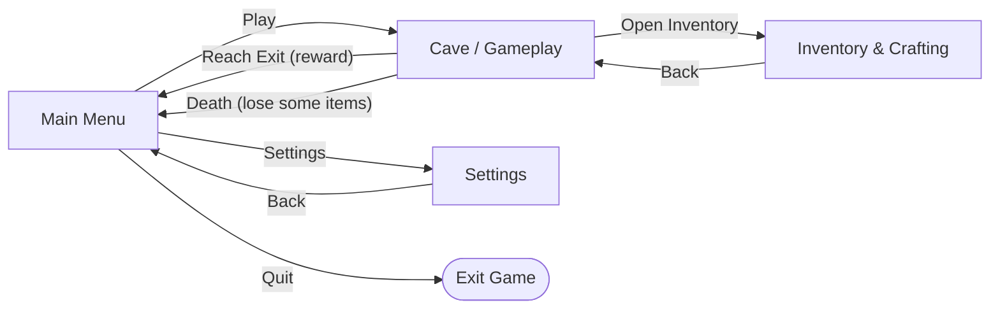
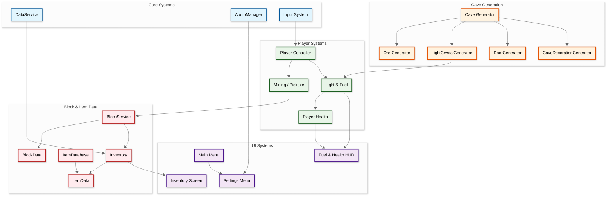
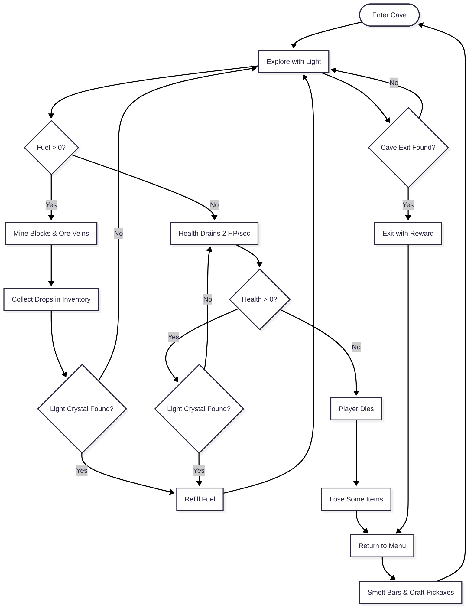

## Developer & Contributions
**Dicco** (Solo Developer: Game Design, Programming & Pixel Art)

## About
Pixel Mines is a 2D pixel-art exploration and incremental mining game. Descend into procedurally generated caves lit only by a light that burns through limited fuel, mine rocks and ore veins, and craft stronger pickaxes to dig faster. Race the dimming light to collect resources and find the cave exit, because if you die you lose some of your items. Even a clean exit earns you a reward.

 

## Key Features

**Light & Fuel Pressure**: Your light drains fuel at 2.5 per second from a full tank of 100. Scatter-placed light crystals (small, medium and large) refill it, so every detour is a gamble between greed and the dark. When the fuel hits zero your health starts draining, and lost HP never regenerates.

**Procedural Caves**: Caves are shaped with cellular automata, filled with rock clusters using Perlin noise, and split by a random-walk hard rock seam. Ore veins spawn with per-ore count limits and depth ranges, so no two runs play the same.

**Mining, Crafting & Upgrades**: Break blocks with your pickaxe (break time depends on the pickaxe material), collect drops into your inventory, smelt ore into bars, and craft copper, iron, gold and diamond pickaxes for faster digging and access to harder rock.

**Risk and Reward**: Find the exit before the light dies. Dying costs you part of your haul, while exiting rewards you, which keeps the incremental "numbers go up" loop tense but satisfying in short sessions.

<table>
<tr>
<td align="center" width="50%">
<strong>Cave Exploration</strong> 
Explore dark procedural caves with a draining light

</td>
<td align="center" width="50%">
<strong>Mining & Ore Veins</strong> 
Break blocks and collect ore to craft better pickaxes

</td>
</tr>
</table>

## Scene Flow

## Layer / Module Design

## Modules and Features

The mining, light-fuel survival, procedural cave generation and crafting gameplay is powered by a Unity C# system built around ScriptableObject data and the new Input System.

| 📂 Name | 🎬 Scene | 📋 Responsibility |
|---------|----------|-------------------|
| **Cave Generator** | **Gameplay** | - Generate the cave map with cellular automata (60% random fill) - Pick the base of the cave and smooth the layout - Fill rock clusters with Perlin noise - Carve the hard rock seam with a top-to-bottom random walk |
| **Ore Generator** | **Gameplay** | - Pick vein counts per ore within min/max limits - Place veins inside each ore's Y-coordinate bounds - Spread ore blocks and clusters with a decaying spawn chance - Randomize neighbor check order each time |
| **LightCrystalGenerator** | **Gameplay** | - Choose random positions for light crystals - Place on ground, add 3 wooden platforms under floating spots, or carve a 3x2 pocket in solid block - Pick small, medium or large crystals by weighted chance |
| **DoorGenerator** | **Gameplay** | - Place the cave doors and exit |
| **CaveDecorationGenerator** | **Gameplay** | - Add stalactites and stalagmites, lilies, rainbow flowers, vines and big vines with end tiles |
| **BlockService** | **Gameplay** | - Handle mining hits on tiles - Track block health against pickaxe material damage - Roll the min/max yield and remove the tile when broken - Send drops to the inventory |
| **BlockData** | **Gameplay** | - ScriptableObject describing a block - Max health per pickaxe material - Min/max yield and the drop item - Tile reference |
| **ItemData / ItemDatabase** | **All Scenes** | - ScriptableObject definition for each item (Id, name, icon) - Central lookup of all items by Id |
| **Inventory** | **All Scenes** | - Store item amounts in a dictionary keyed by item Id - Add and remove items for mining and crafting - Notify the inventory UI of changes |
| **DataService** | **All Scenes** | - Save and load player data as JSON |
| **Light & Fuel** | **Gameplay** | - Drain fuel at 2.5 per second from 100 - Refill fuel from light crystals - Drain health at 2 HP per second when fuel is empty - Trigger death when health reaches 0 |
| **AudioManager** | **All Scenes** | - Control music and sound effects through an AudioMixer - Apply volume settings from the audio tab |
| **Main Menu** | **Main Menu** | - Play, Settings and Quit buttons |
| **Settings Menu** | **Main Menu** | - General and Audio tabs with a Back button |
| **Inventory Screen** | **Gameplay** | - Scrollable grid of item slots (icon, name, amount) - Back button |

 

## Core Loop

## Resources, Blocks & Crafting

**Ore veins** are generated per cave within depth (Y) bounds, with a spawn chance that drops as the vein grows.

| Ore | Y Min | Y Max | Initial Chance | Chance Depletion (Block / Cluster) | Block vs Cluster Chance |
|-----|-------|-------|----------------|------------------------------------|-------------------------|
| Coal | 0 | 30 | 100 | 5 | 70 / 30 |
| Copper | 20 | 60 | 100 | 10 | 70 / 30 |
| Iron | 50 | 80 | 100 | 30 | 80 / 20 |
| Gold | 90 | 120 | 100 | 30 | 80 / 20 |
| Diamond | 120 | 200 | 100 | 30 | 80 / 20 |

**Blocks** take fewer hits with better pickaxes (hits listed from weakest to strongest pickaxe material):

| Block | Hits to Break | Yield |
|-------|---------------|-------|
| Soil, Sand, Clay | 3 → 1 | 1 |
| Cobblestone, Granite, Sandstone | 4 → 1 | 1 |
| Medium Rock | 6 → 2 | 1 |
| Hard Rock | 10 → 3 | 1 |
| Coal / Copper Ore | 4 → 1 | 1 to 3 |
| Iron / Gold Ore | 6 → 2 | 1 to 3 |
| Diamond Ore | 10 → 3 | 1 |
| Coal / Copper Cluster | 3 → 1 | 3 to 5 |
| Iron Cluster | 4 → 1 | 3 to 5 |
| Gold Cluster | 6 → 2 | 3 to 5 |
| Diamond Cluster | 10 → 3 | 2 to 3 |
| Bedrock | Unbreakable | 1 |

**Crafting**:

| Item | Recipe |
|------|--------|
| Coal / Copper / Iron / Gold / Diamond Bar | 9 of the matching ore |
| Copper Pickaxe | 20 Copper Bars |
| Iron Pickaxe | 5 Copper Bars + 10 Iron Bars |
| Gold Pickaxe | 5 Iron Bars + 10 Gold Bars |
| Diamond Pickaxe | 5 Gold Bars + 10 Diamond Bars |

**Light crystals**:

| Size | Fuel Restored | Spawn Chance |
|------|---------------|--------------|
| Small | 10 | 20% |
| Medium | 40 | 30% |
| Large | 80 | 50% |

 

## Play The Game
<a href="https://YOUR-ITCH-LINK-HERE">Play Now on itch.io</a>

 

## Installation & Setup
1. Clone this repository
2. Open the project in Unity (6.3 LTS recommended)
3. Open the main menu scene
4. Press Play to start testing

## Controls
<!-- Update these to match your Input System bindings -->
- **Move / Mine / Open Inventory** - See the Input Actions asset in the project

## Credits
Game designed, programmed and drawn by Dicco as a solo project.

- Engine: Unity
- Pixel art: Aseprite
- Sound: Pixabay
- Cave generation inspired by the cellular automata approach and by the mining caves of Pixel World
